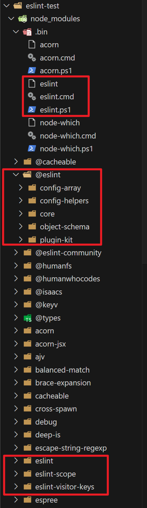
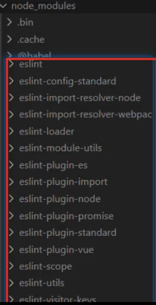
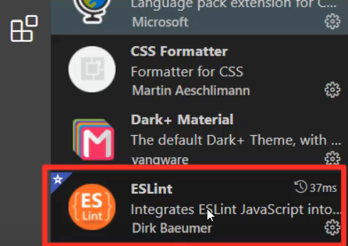
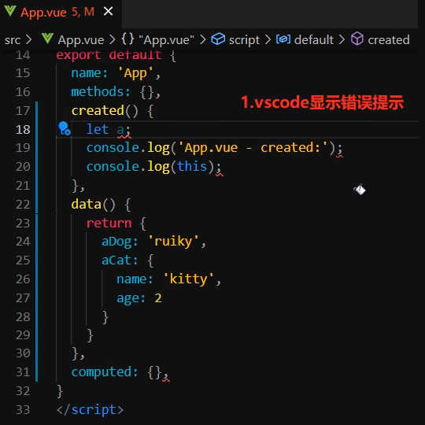

## ESLint 介绍

ESLint是在ECMAScript / JavaScripts代码中识别和报告模式匹配的工具, 目标是保证代码的一致性和避免错误, 在许多的方面他和JSLint, JSHint相似

> **<font color=red>eslint是完全插件化的, 每个规则都是插件, 并且你可以在运行时添加更多的规则</font>**
>
> **<font color=red>eslint默认只检查js语法, 如果想要检查vue, react的语法, 就要安装插件了</font>**


### 为什么要用eslint

使用eslint, 可以帮助我们

- 同一团队的编码规范(命名, 代码风格)
- 同一语法标准, 毕竟es版本已经不少了 (var / let....)
- 减少不必要的git提交  (如果git修改只是增加修改了空格, 那么这样的git提交是无意义的)
- 减少不必要的低级错误
- 在编译时检查语法, 而不是等js运行时才检查


## 使用ESLint


### 1. eslint的安装方式

#### 普通项目安装eslint

如果你是普通的npm项目, 那么你可以通过如下的方式来安装eslint

~~~shell
npm install -D eslint
~~~

之后会在`node_modules`中出现如下的安装包



- `.bin/eslint`, `.bin/eslint.cmd`, `.bin/eslint.ps1`主要是用来在nodejs中运行eslint的命令, 有了这三个脚本之后, 你就可以通过如下命令来执行eslint了

  ```shell
  $ npx eslint -- --version
  v10.15.0
  ```

- `@eslint`包用来规范eslint配置文件的

- eslint开头的包是eslint的核心包, 包含eslint的代码

#### vue项目中安装eslint

如果你是通过vue脚手架来创建项目, 那么可以通过如下命令来创建项目, 并在创建项目的过程中选择eslint

   ~~~shell
   Shen@Wind MINGW64 /j/desktop-shortcut/example/example4all/frontend/example4eslint (main)
   $ npm create vue
   npm http fetch GET 200 https://registry.npmjs.org/create-vue 396ms (cache revalidated)
   
   > example4eslint@1.0.0 npx
   > create-vue
   
   ┌  Vue.js - The Progressive JavaScript Framework
   │
   ◇  Project name (target directory):
   │  vue-project
   │
   ◇  Use TypeScript?
   │  Yes
   │
   ◆  Select features to include in your project: (↑/↓ to navigate, space to select, a to toggle all, enter to confirm)
   │  ◼ JSX Support
   │  ◼ Router (SPA development)
   │  ◼ Pinia (state management)
   │  ◼ Vitest (unit testing)
   │  ◻ End-to-End Testing
   │  ◼ Linter (error prevention)
   │  ◼ Prettier (code formatting)
   └
   ~~~




### 2. eslint的配置文件

在项目中, 我们可以通过`npx eslint --init`来创建对应的eslint的配置文件

~~~shell
$ npx eslint --init
You can also run this command directly using 'npm init @eslint/config@latest'.
npm http fetch GET 200 https://registry.npmjs.org/@eslint%2fcreate-config 548ms (cache revalidated)

> eslint-in-npm@1.0.0 npx
> create-config

@eslint/create-config: v3.1.0
? What do you want to lint? ...  // 选择哪些内容要进行lint
(*) JavaScript
(*) JSON
(*) JSON with comments
(*) JSON5
( ) Markdown
(*) CSS
( ) Shell scripts (Bash, sh)   

? How would you like to use ESLint? ... // 怎么样使用eslint
> To check syntax only                  // 检测代码语法
  To check syntax and find problems     // 检查代码语法和查找问题
  
? What type of modules does your project use? ...  // 使用怎么样的js导入导出语法
> JavaScript modules (import/export)
  CommonJS (require/exports)
  None of these
  
? Which framework does your project use? ...  // 当前项目使用到了什么框架, 会导入对应框架的eslint检查插件
> React
  Vue.js
  None of these

? Does your project use TypeScript? » No / Yes // 是否使用ts

? Where does your code run? ...  (Press <space> to select, <a> to toggle all, <i> to invert  selection) // 在哪里运行代码, 浏览器或者node
(*) Browser
( ) Node

// 上面配置的这些选项需要依赖一些npm包, 是否立即安装
i The config that you've selected requires the following dependencies:

eslint, @eslint/js, globals
? Would you like to install them now? » No / Yes

// 当前项目使用什么包管理器
? Which package manager do you want to use? ...
> npm
  yarn
  pnpm
  bun
  
// 安装依赖包之后, 成功创建了eslint的配置文件eslint.config.mjs
√ Successfully created J:\desktop-shortcut\example\example4all\frontend\example4eslint\eslint-in-npm\eslint.config.mjs file.
~~~


之后会在项目中创建一个`eslint.config.mjs`文件 (我们是es module的语法, 所以是mjs文件, 如果你是common js的语法, 那么创建的是cjs文件), 内容如下

~~~js
import js from "@eslint/js";
import globals from "globals";
import { defineConfig } from "eslint/config";

export default defineConfig([
  {
    files: ["**/*.{js,mjs,cjs}"],
    plugins: { js },
    extends: ["js/recommended"],
    languageOptions: { globals: globals.browser },
  },
]);
~~~

并且还在package.json中导入了一些eslint的相关包

~~~json
  "devDependencies": {
    "@eslint/js": "^10.0.1",
    "eslint": "^10.15.0",
    "globals": "^17.14.0"
  }
~~~

> npm init @eslint/config@latest


### 3. 使用eslint

有了配置文件之后, 你可以执行如下的命令来运行eslint, 并检查语法, 风格等等

~~~shell
npx eslint . # 检查当前目录下的所有文件

npmx eslint src/ # 检查指定的文件夹

npx eslint src/index.js # 检查指定的文件 
~~~


### 4. vscode中eslint的扩展工具

vscode中有eslint对应的插件



安装了这个插件之后, 这个插件会在后台启动一个eslint服务器, 然后读取当前项目的eslint配置, 然后将错误信息实时的显示在vscode的编辑界面上



## eslint的配置文件说明

### 1. 配置文件的格式

eslint支持如下格式的配置文件

| 文件名              | 模块规范            | 配置格式   |
| ------------------- | ------------------- | ---------- |
| `eslint.config.js`  | 取决于 package.json | JavaScript |
| `eslint.config.mjs` | ESM                 | JavaScript |
| `eslint.config.cjs` | CommonJS            | JavaScript |
| `eslint.config.ts`  | 取决于 TS 加载方式  | TypeScript |
| `eslint.config.mts` | ESM                 | TypeScript |
| `eslint.config.cts` | CommonJS            | TypeScript |

> 推荐如果启用了ts, 那么使用ts的格式, 如果没有启用ts, 那么使用mjs的格式
>
> 除非明确要使用cjs/cts, 否则不要使用这两种格式