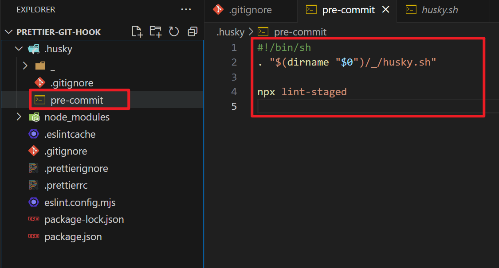
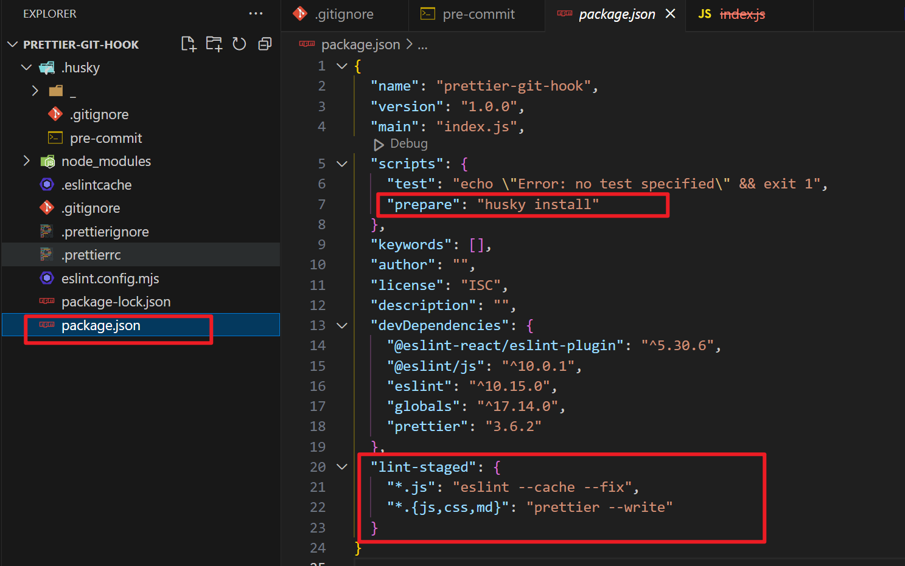
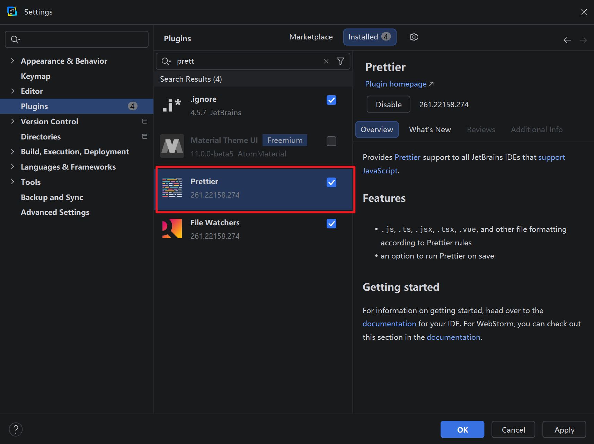

# Prettier的理念

Prettier是一个代码格式化工具, 他和eslint在理念上有着非常的不同

- 在eslint中, 他是由非常多的规则进行组成的, 你可以对不同的规则进行开关, 也可以定制他们的告警等级, 这样就可以拥有非常定制化的配置了

- 但是在prettier中, 他的理念是尽量少的, 或者不提供配置(少量的配置也只是因为历史原因),  你使用了Prettier, 那么就使用了一种固定的代码格式, 没有什么可以配置的

  他这样做的目标是为了结束代码格式的争论, 有的人喜欢双引号字符串, 有的喜欢单引号, 这些都是非常定制化的东西, 但是在使用Prettier之后, 这些就没什么好争论的了, 一切按照Prettier的来就好了, 也没什么可以配置的

具体的文档可以查看https://prettier.io/docs/option-philosophy


# 安装

首先在项目中安装Prettier

~~~shell
npm install --save-dev --save-exact prettier@3.6.2
yarn add --dev --exact prettier@3.6.2
pnpm add --save-dev --save-exact prettier@3.6.2
bun add --dev --exact prettier@3.6.2
deno install --dev --save-exact prettier@3.6.2
~~~

> 注意, prettier每个版本的代码风格都有可能有细微的差异, 所以在install的时候, 不要用latest来进行安装, 这样你不知道安装的是什么版本
>
> 并且在安装的时候添加`--save-exact`项目, 这个选项是在生成`devDependencies`的时候, 不要生成`^3.6.2`这样的版本号, 这样的版本号是浮动的, 这会导致团队的每个成员的版本号都不一样, 代码格式也不一样, 而是应该使用`3.6.2`这样精准的版本号


然后创建一个Prettier的配置文件`.prettierrc`文件, 这样编辑器和其他的工具就知道正在使用Prettier了

~~~shell
# 通过node执行代码来生成文件
node --eval "fs.writeFileSync('.prettierrc','{}\n')"
~~~

然后再创建一个`.prettierignore`文件, 这样可以告诉Prettier, 哪些是不需要格式化的文件

~~~shell
node --eval "fs.writeFileSync('.prettierignore','# Ignore artifacts:\nbuild\ncoverage\n')"
~~~

安装prettier之后, 你可以使用如下的命令来执行prettier来进行代码格式化

~~~shell
npx prettier . --write # 格式化所有文件
yarn exec prettier . --write
pnpm exec prettier . --write
bunx prettier . --write
deno x prettier . --write

prettier --write app/ # 指定目录
prettier --write app/components/Button.js # 指定特定的文件
prettier --write "app/**/*.test.js" # 使用通配符匹配文件
~~~


你也可以将prettier集成到CICD中, 比如git action

~~~yaml
name: Code Format Check
on:
  push:
  pull_request:
jobs:
  prettier:
    runs-on: ubuntu-latest
    steps:
      - uses: actions/checkout@v4
      - uses: actions/setup-node@v4
        with:
          node-version: 22
      - run: npm ci
      - run: npx prettier . --check
~~~

`npx prettier . --check` 这个命令会检查代码的格式是否有问题, 而不是重新格式化代码

如果代码格式有问题的话, 那么这个命令的退出状态码非零


# 配置

## 配置文件

你可以通过以下方式配置 Prettier（**按照优先级从高到低排列**）：

1. 在 `package.json` 文件或 [`package.yaml`](https://github.com/pnpm/pnpm/pull/1799?utm_source=chatgpt.com) 文件中配置一个 `"prettier"` 键。

2. 使用 JSON 或 YAML 格式编写 `.prettierrc` 文件。

3. 使用以下文件之一进行配置：

   - `.prettierrc.json`
   - `.prettierrc.yml`
   - `.prettierrc.yaml`
   - `.prettierrc.json5`

4. 使用以下 JavaScript 或 TypeScript 文件进行配置：

   - `.prettierrc.js`
   - `prettier.config.js`
   - `.prettierrc.ts`
   - `prettier.config.ts`

   这些文件需要导出一个对象，可以使用 `export default` 或 `module.exports`，具体取决于 `package.json` 中的 `type` 字段。

5. 使用以下 ES Module 格式的文件进行配置：

   - `.prettierrc.mjs`
   - `prettier.config.mjs`
   - `.prettierrc.mts`
   - `prettier.config.mts`

   这些文件使用 `export default` 导出一个配置对象。

6. 使用以下 CommonJS 格式的文件进行配置：

   - `.prettierrc.cjs`
   - `prettier.config.cjs`
   - `.prettierrc.cts`
   - `prettier.config.cts`

   这些文件使用 `module.exports` 导出一个配置对象。

7. 使用 `.prettierrc.toml` 文件进行配置。


> prettier会从要格式化的文件的位置开始, 向上查找配置文件, 直到找到, 所以**不同的子目录下可以有不同的配置文件**

> TypeScript 支持需要 Node.js 版本 22.6.0，而 Node.js 版本 24.3.0 之前需要使用 `--experimental-strip-types` 参数才能运行 Node.js。
>
> ```shell
> node --experimental-strip-types node_modules/prettier/bin/prettier.cjs . --write
> ```
>
> 或者
>
> ```shell
> NODE_OPTIONS="--experimental-strip-types" prettier . --write
> ```


## 基本配置

你可以使用一下的格式来对prettier进行配置

1. .prettierrc.json或者.prettierrc

   ~~~json
   {
     // 这里是全局配置, 针对所有文件
     "trailingComma": "es5",
     "tabWidth": 4,
     "semi": false,
     "singleQuote": true,
     // 这里是对特定的文件进行单独配置
     "overrides": [
       { 
         
         "files": ["**/*/*.js", "dist/**/*"], // 指定特定的文件
         "excludeFiles":["src/**/*.html", "dist/**/*.html"] // 指定要忽略的文件
         "options": {  // 指定这些文件应该使用的配置
           "semi": true
         }
       },
       {
         "files": ["*.html", "legacy/**/*.js"],
         "options": {
           "tabWidth": 4
         }
       }
     ]
   }
   ~~~

2. prettier.config.mjs, .prettierrc.mjs, prettier.config.js, or .prettierrc.js

   ~~~js
   const config = {
     trailingComma: "es5",
     tabWidth: 4,
     semi: false,
     singleQuote: true,
   };
   
   export default config;
   ~~~

3. prettier.config.cjs、.prettierrc.cjs、prettier.config.js 或 .prettierrc.js

   ~~~js
   const config = {
     trailingComma: "es5",
     tabWidth: 4,
     semi: false,
     singleQuote: true,
   };
   
   module.exports = config;
   ~~~

4. prettier.config.mts、.prettierrc.mts、prettier.config.ts 或 .prettierrc.ts


   ~~~ts
   import { type Config } from "prettier";
   
   const config: Config = {
     trailingComma: "none",
   };
   
   export default config;
   ~~~

5. prettier.config.cts、.prettierrc.cts、prettier.config.ts 或 .prettierrc.ts

   ~~~ts
   import { type Config } from "prettier";
   
   const config: Config = {
     trailingComma: "none",
   };
   
   module.exports = config;
   ~~~

6. .prettierrc、.prettierrc.yml 或 .prettierrc.yaml

   ~~~yaml
   trailingComma: "es5"
   tabWidth: 4
   semi: false
   singleQuote: true
   ~~~

7. .prettierrc.toml

   ~~~toml
   trailingComma = "es5"
   tabWidth = 4
   semi = false
   singleQuote = true
   ~~~

   

## 可共享配置

可共享配置就是将你的Prettier配置, 打包到一个npm包中, 然后别人只要install你的包, 然后就可以直接使用你的配置来配置Prettier了

1. 我们创建一个新的npm包, 名为`@username/prettier-config`

   这个包的结构如下

   ~~~txt
   prettier-config/
   ├── index.js
   └── package.json
   ~~~

   package.sjon的内容如下:

   ~~~json
   {
     "name": "@username/prettier-config",
     "version": "1.0.0",
     "description": "My personal Prettier config",
     "type": "module",
     "exports": "./index.js",
     "license": "MIT",
     "publishConfig": {
       "access": "public"
     },
     "peerDependencies": {
       "prettier": ">=3.0.0"
     },
     "devDependencies": {
       "prettier": "3.10.1"
     }
   }
   ~~~

2. 之后编写index.js,  这个文件的主要内容是导出一个Prettier配置对象

   ~~~js
   const config = {
     trailingComma: "es5",
     tabWidth: 4,
     singleQuote: true,
   };
   
   export default config;
   ~~~

3. 将这个包发布到npm上面

   ~~~shell
   npm publish
   ~~~

4. 要使用这个包, 执行如下的命令

   ~~~shell
   npm install --save-dev @username/prettier-config
   ~~~

5. 在配置文件中使用这个npm包中的Prettier配置

   ~~~json
   import usernamePrettierConfig from "@username/prettier-config";
   
   const config = {
     ...usernamePrettierConfig, // 获取配置对象, 然后扩展出所有的属性
     semi: false, // 这里可以覆盖npm包中的配置, 进行自己的定制化
   };
   
   export default config;
   ~~~


## 所有配置选项

1. 行的宽度, 超过宽度换行

   ~~~js
   const config = {
     printWidth: 80 // 默认值80
   };
   export default config;
   ~~~

2. 每个缩进的空格的个数

   ~~~js
   const config = {
     tabWidth: 2 // 默认值2
   };
   export default config;
   ~~~

3. 使用tab, 而不是空格缩进

   使用`useTabs`进行配置, 默认为false

   注意, 开启后tab只用于**缩进**, 对齐(比如三元表达式的对齐)仍然使用空格, 这种行为被称为SmartTabs

4. 在每个语句的末尾添加分号

   使用`semi`进行配置, 默认为true

   设置为false之后, 只会在可能因为ASI(自动分号插入)而出错的行首添加分号

5. 使用单引号而不是双引号

   使用`singleQuote`进行配置, 默认为false

   这个配置不影响JSX中的引号, JSX由`jsxSingleQuote`单独控制; 另外, 如果字符串里的单引号比双引号多, Prettier会自动改用双引号, 反之亦然

6. 控制对象属性名什么时候需要加引号

   使用`quoteProps`进行配置, 默认为`"as-needed"`, 可选值:
   - `"as-needed"`: 只在必须加引号的时候才加
   - `"consistent"`: 只要对象中有一个属性需要加引号, 那么所有属性都加引号
   - `"preserve"`: 保留你输入时是否加引号

   注意, 在Angular表达式、TypeScript和Flow中, Prettier永远不会去掉数字属性名的引号, 因为在这几种语言里字符串key和数字key是有区别的

7. 在JSX中使用单引号而不是双引号

   使用`jsxSingleQuote`进行配置, 默认为false

8. 在多行结构的末尾添加尾随逗号

   使用`trailingComma`进行配置, 默认为`"all"`(从3.0.0开始默认值由`"es5"`改成了`"all"`), 可选值:
   - `"all"`: 尽可能添加, 包括函数参数和函数调用
   - `"es5"`: 只在ES5合法的位置添加(对象、数组等)
   - `"none"`: 不添加

   单行的数组之类的结构永远不会添加尾随逗号

9. 在对象的花括号内打印空格

   使用`bracketSpacing`进行配置, 默认为true

   true时输出`{ foo: bar }`, false时输出`{foo: bar}`

10. 控制对象字面量如何换行

    使用`objectWrap`进行配置, 默认为`"preserve"`(3.5.0新增), 可选值:
    - `"preserve"`: 如果左花括号和第一个属性之间有换行, 就保持多行
    - `"collapse"`: 能放到一行时就放到一行

    默认值`"preserve"`让你可以通过输入时的换行来表达"这个对象我想让它多行"的意图

11. 多行标签的`>`放在最后一行的末尾, 而不是单独占一行

    使用`bracketSameLine`进行配置, 默认为false

    true时`>`跟在最后一个属性的后面, false时`>`单独占一行

    只对HTML、JSX、Vue、Angular的多行元素有效, 自闭合元素不受影响

    另外, `jsxBracketSameLine`这个选项在2.4.0已经废弃, 请使用`bracketSameLine`代替

12. 只有一个参数的箭头函数是否加括号

    使用`arrowParens`进行配置, 默认为`"always"`(2.0.0起默认值由`"avoid"`改为`"always"`), 可选值:
    - `"always"`: 总是加括号, 如`(x) => x`
    - `"avoid"`: 能省则省, 如`x => x`

    统一加括号是为了以后添加类型注解、额外参数或者默认值时更方便

13. 只格式化文件中的一段代码

    使用`rangeStart`和`rangeEnd`进行配置, 默认值分别是0和Infinity, 也就是整个文件

    他们接收的是字符偏移量(左闭右开), 最终格式化的范围会扩展成: 从`rangeStart`所在语句的第一行行首开始, 到`rangeEnd`所在语句的末尾结束

    这两个选项一般只在CLI和API中使用, 不适合写在配置文件里

14. 指定解析器

    使用`parser`进行配置, 没有默认值, Prettier会根据文件路径自动推断, 所以一般不需要配置

    常用的可选值有: `"babel"`、`"babel-ts"`、`"typescript"`、`"flow"`、`"babel-flow"`、`"espree"`、`"acorn"`、`"meriyah"`(JS/TS), `"css"`、`"scss"`、`"less"`, `"json"`、`"json5"`、`"jsonc"`、`"json-stringify"`, `"graphql"`, `"markdown"`、`"mdx"`, `"html"`、`"vue"`、`"angular"`、`"lwc"`、`"mjml"`, `"yaml"`

15. 指定文件名, 让Prettier据此推断解析器

    使用`filepath`进行配置, 没有默认值(CLI中对应`--stdin-filepath`)

    这个选项只在CLI和API中有意义, 配置文件中不需要写, 因为配置文件本来就是针对真实文件的

16. 只格式化包含pragma注释的文件

    使用`requirePragma`进行配置, 默认为false

    开启后, 只有文件第一个docblock注释中包含`@prettier`或者`@format`时, 这个文件才会被格式化, 适合在大型的、尚未格式化的老项目中逐步接入Prettier

17. 给已经格式化的文件插入`@format`注释

    使用`insertPragma`进行配置, 默认为false

    它会在文件顶部的docblock注释中插入`@format`标记, 通常和`requirePragma`配合使用

    注意两者同时开启时`requirePragma`优先, `insertPragma`会被忽略; 一般是参与迁移的人用`insertPragma`, 团队其他人用`requirePragma`只处理已经迁移完的文件

18. 检查忽略pragma, 让单个文件跳过格式化

    使用`checkIgnorePragma`进行配置, 默认为false(3.6.0新增)

    开启后, 如果文件第一个注释中包含`@noprettier`或者`@noformat`, 那么这个文件不会被格式化

    因为每次都要检查这个注释, 会有额外的开销, 所以默认不开启

19. 控制markdown中散文(prose)的换行

    使用`proseWrap`进行配置, 默认为`"preserve"`, 可选值:
    - `"always"`: 超过printWidth就换行
    - `"never"`: 不换行, 把每个段落合并成一行
    - `"preserve"`: 保持原样, 不做任何修改

    Prettier默认不动markdown的换行, 因为GitHub评论等场景对换行敏感

20. HTML空白字符的敏感程度

    使用`htmlWhitespaceSensitivity`进行配置, 默认为`"css"`, 可选值:
    - `"css"`: 尊重CSS的`display`属性的默认值
    - `"strict"`: 所有标签周围的空白(或者没有空白)都被认为是有意义的
    - `"ignore"`: 所有标签周围的空白都被认为是无意义的

    这个选项影响HTML、Vue、Angular和Handlebars

21. Vue文件中`<script>`和`<style>`标签内部的代码是否缩进

    使用`vueIndentScriptAndStyle`进行配置, 默认为false

22. 换行符类型

    使用`endOfLine`进行配置, 默认为`"lf"`(2.0.0起默认值由`"auto"`改为`"lf"`), 可选值:
    - `"lf"`: 只用`\n`, Linux、macOS以及git仓库中的常见形式
    - `"crlf"`: 使用`\r\n`, Windows上的常见形式
    - `"cr"`: 只用`\r`, 非常少见
    - `"auto"`: 保持文件原有的换行符, 同一个文件中混用时, 以第一行之后的换行为准

    Prettier默认使用`lf`, 是为了避免不同操作系统的人协作时产生大量的换行符diff

23. 是否格式化文件里嵌入的其他语言的代码

    使用`embeddedLanguageFormatting`进行配置, 默认为`"auto"`, 可选值:
    - `"auto"`: 只要能自动识别出来就格式化
    - `"off"`: 从不自动格式化嵌入的代码

    比如js中标签为`html`的模板字符串、markdown中的代码块, 默认都会被格式化

24. 每个属性单独占一行

    使用`singleAttributePerLine`进行配置, 默认为false

    影响HTML、Vue和JSX

25. 实验性的三元表达式格式化

    使用`experimentalTernaries`进行配置, 默认为false(3.1.0引入)

    开启后会使用"curious ternaries"风格, 把问号放在条件后面; 这是实验性功能, 以后可能会成为默认行为

26. 实验性的运算符位置

    使用`experimentalOperatorPosition`进行配置, 默认为`"end"`(3.5.0引入), 可选值:
    - `"start"`: 二元表达式换行时, 运算符放在新行的行首
    - `"end"`: 运算符放在上一行的行尾(默认行为)

# 忽略文件

你可以在项目的根目录下面创建一个`.prettierignore`文件, 告诉prettier哪些文件是不需要格式化的

如果项目中已经存在 `.eslintignore`, 你可以将`.eslintignore`文件中的内容直接复制到`.prettierignore`中, 这样不需要从0开始配置这个文件, 而且他们的格式都是一样的, 这样ESLint 和 Prettier 就可以使用相同的文件忽略范围。

~~~.prettierignore
# Ignore artifacts:
build
coverage

# Ignore all HTML files:
**/*.html
~~~


默认的情况下, prettier会自动的忽略如下文件

~~~txt
**/.git
**/.svn
**/.hg
**/node_modules
~~~


如果你的项目根目录下面有`.gitignore`文件, 那么这个文件中指定的文件, prettier也不会格式化


## 内联注释

如果你不想在`.prettierignore`中添加全局的文件忽略, 只想要忽略特定文件中的部分内容, 那么你可以使用注释来指定忽略

1. js

   ~~~js
   matrix(
     1, 0, 0,
     0, 1, 0,
     0, 0, 1,
   );
   
   // prettier-ignore
   matrix(
     1, 0, 0,
     0, 1, 0,
     0, 0, 1,
   );
   ~~~

   格式话之后变成

   ~~~js
   matrix(1, 0, 0, 0, 1, 0, 0, 0, 1);
   
   // prettier-ignore
   matrix(
     1, 0, 0,
     0, 1, 0,
     0, 0, 1,
   );
   ~~~

2. jsx

   ~~~jsx
   <div>
     {/* prettier-ignore */}
     <span     ugly  format=''   />
   </div>
   ~~~

3. html

   ~~~xml
   <!-- prettier-ignore -->
   <div         class="x"       >hello world</div            >
   
   <!-- prettier-ignore-attribute -->
   <div
     (mousedown)="       onStart    (    )         "
     (mouseup)="         onEnd      (    )         "
   ></div>
   
   <!-- prettier-ignore-attribute (mouseup) -->
   <div
     (mousedown)="onStart()"
     (mouseup)="         onEnd      (    )         "
   ></div>
   ~~~

4. css

   ~~~css
   /* prettier-ignore */
   .my    ugly rule
   {
   
   }
   ~~~

5. markdown

   ~~~xml
   <!-- prettier-ignore -->
   Do   not    format   this
   ~~~

   markdown也支持范围忽略, 这个功能只要是用来忽略自动生成的内容的, 比如说toc

   ~~~markdown
   <!-- prettier-ignore-start -->
   <!-- SOMETHING AUTO-GENERATED BY TOOLS - START -->
   
   | MY | AWESOME | AUTO-GENERATED | TABLE |
   |-|-|-|-|
   | a | b | c | d |
   
   <!-- SOMETHING AUTO-GENERATED BY TOOLS - END -->
   <!-- prettier-ignore-end -->
   ~~~

6. yaml

   ~~~yaml
   # prettier-ignore
   key  : value
   ~~~


# Prettier和ESLinter

Linter的翻译是代码检查器, 常见的比如ESLint, 他有两个大类的功能

- 代码风格的格式化, 比如最大长度, 禁止tab等等
- 代码质量检查, 比如禁止未使用的变量, 不使用隐式的全局变量等等

而Prettier的作用是进行代码风格的格式化, 相当于ESLint和Prettier他们的功能是有交集的, 所以在这里推荐:

<font color=red>使用Prettier做代码格式化, 使用eslint做代码质量检查, 然后使用[eslint-config-prettier](https://github.com/prettier/eslint-config-prettier)来关闭eslint中可能会与prettier冲突的规则, eslint只专心做代码格式化, 这个插件是prettier官方写的</font>


安装eslint, 并添加eslint的配置文件

```shell
npm init @eslint/config@latest
```


安装prettier, eslint-config-prettier

~~~shell
npm install -D prettier eslint-config-prettier
~~~

添加`.prettierrc, .prettierignore`文件


在`eslint.config.mjs`文件中添加配置

~~~js
import js from '@eslint/js';
import globals from 'globals';
import prettier from 'eslint-config-prettier';

export default [
  // 忽略不需要检查的目录
  {
    ignores: ['node_modules/**', 'dist/**', 'build/**', 'coverage/**'],
  },

  // ESLint 官方推荐规则
  js.configs.recommended,

  // JavaScript 项目的基础配置
  {
    files: ['**/*.js', '**/*.mjs'],
    languageOptions: {
      ecmaVersion: 'latest',
      sourceType: 'module',
      globals: {
        ...globals.node,
        ...globals.browser,
      },
    },
  },

  // 必须放在其他规则配置之后
  prettier,
];
~~~

这里最重要的是最后这一项：

```
prettier
```

它实际上就是 `eslint-config-prettier` 导出的配置，会关闭与 Prettier 冲突的 ESLint 格式规则。

他必须放在最后面, 因为 ESLint 配置是按顺序合并的。把它放在最后，才能覆盖前面其他配置中可能启用的格式规则。


# Prettier和Git 

## Prettier和husky/lint-staged

如果你想要在git commit之前, 运行eslint和prettier, 那么可以按照如下的内容来

1. 首先确保你已经正确的安装了prettier, 并且将其添加到了`devDependencies`中

2. 执行如下命令

   ~~~shell
   # 这个命令是执行mrm的2版本, 然后传入了一个lint-staged的命令
   npx mrm@2 lint-staged
   ~~~

3. 上面的命令执行之后会有如下的改动

   1. 会帮你自动安装`husky`和`lint-staged`, 并配置好git的`pre-commit`

      > 注意查看devDependencies中有没有husky和lint-staged, 如果没有的话要自己安装一下, 正常情况下是会有的
   
   2. 会生成一个`.husky`的文件夹, 其中有一个`pre-commit`的文件
   
      
   
   3. 在package.json中添加如下的内容
   
      


husky和lint-staged的原理在于

1. 安装的时候, 会执行`git config core.hooksPath`命令, 将hook的地址指向`.husky`目录, 这样在`git commit`的时候就可以调用到husky中的hook了, 并且这个`.husky`目录还是被git版本控制的, 可以被共享

2. 当别人拿到你的项目的时候, 会执行`npm install`这个命令来安装依赖, 那么就会触发package.json中的`prepare`这个命令, 这是npm的一个生命周期的hook, 在`npm install`之后执行

   这个`prepare`命令会执行`husky install`命令, 其实也就是执行`git config core.hooksPath`命令, 将hook的地址指向`.husky`目录, 这样别人的项目中, git的hook也被husky接管了

3. 然后每次git commit之前, 都会执行pre-commit这个hook, 然后执行其中的`npx lint-staged`这个命令

   这个命令会读取package.json中的lint-staged配置对象

   ~~~txt
     "lint-staged": {
       # 获取暂存区中的文件, 过滤出js文件, 然后执行eslit
       "*.js": "eslint --cache --fix", 
       # 获取暂存区中的文件, 过滤出js,css,md文件, 然后执行eslit
       "*.{js,css,md}": "prettier --write" 
     }
   ~~~

   命令的执行时从上到下的, 所以js文件先被eslint, 然后prettier格式化

   最后husky会将修改后的文件重新调用`git add`添加回暂存区, 然后再执行`git commit`


## Prettier和simple-git-hooks/lint-staged

simple-git-hooks 是 husky 的一个轻量替代方案, 整个工具只有约100行代码, 配置全部写在package.json中, 不需要额外的`.husky`目录, 适合只需要1~2个简单钩子的项目

如果你想要在git commit之前, 运行eslint和prettier, 那么可以按照如下的内容来

1. 首先确保你已经正确的安装了prettier, 并且将其添加到了`devDependencies`中

2. 安装simple-git-hooks和lint-staged

   ~~~shell
   npm install --save-dev simple-git-hooks lint-staged
   ~~~

3. 在package.json中添加如下的配置

   ~~~json
   {
     "scripts": {
       "postinstall": "simple-git-hooks"
     },
     "simple-git-hooks": {
       "pre-commit": "npx lint-staged"
     },
     "lint-staged": {
       "*.js": "eslint --cache --fix",
       "*.{js,css,md}": "prettier --write"
     }
   }
   ~~~

4. 手动执行一次, 让钩子立即生效(否则要等到下次`npm install`才会激活)

   ~~~shell
   npx simple-git-hooks
   ~~~

5. 验证效果

   ~~~shell
   git add .
   git commit -m "test"   # 提交前会自动对暂存区的文件执行eslint和prettier
   ~~~


simple-git-hooks和lint-staged的原理在于

1. git本身提供了一系列的钩子(hooks), 比如`pre-commit`(提交前)、`commit-msg`(提交信息写入时), 这些钩子本质是`.git/hooks/`目录下的脚本文件, git在对应时机执行它们, 脚本退出码非零时, git就中止这次操作

2. simple-git-hooks的安装/激活方式和husky不同: 它**不改`core.hooksPath`, 而是直接把钩子脚本写入`.git/hooks/`目录**

   执行`npx simple-git-hooks`时, 它会读取package.json中的`simple-git-hooks`配置对象, 然后在`.git/hooks/`目录下生成对应的钩子文件(比如`pre-commit`), 文件内容就是调用你配置的命令(`npx lint-staged`)

3. 当别人拿到你的项目的时候, 会执行`npm install`这个命令来安装依赖, 那么就会触发package.json中的`postinstall`这个命令, 这是npm的一个生命周期的hook, 在`npm install`之后执行

   这个`postinstall`命令会执行`simple-git-hooks`命令, 重新把钩子写入别人本地的`.git/hooks/`目录, 这样别人的项目中, git的hook也被接管了

4. 然后每次git commit之前, 都会执行`.git/hooks/pre-commit`这个脚本, 然后执行其中的`npx lint-staged`这个命令

   这个命令会读取package.json中的lint-staged配置对象

   ~~~txt
     "lint-staged": {
       # 获取暂存区中的文件, 过滤出js文件, 然后执行eslint
       "*.js": "eslint --cache --fix", 
       # 获取暂存区中的文件, 过滤出js,css,md文件, 然后执行prettier
       "*.{js,css,md}": "prettier --write" 
     }
   ~~~

   命令的执行是从上到下的, 所以js文件先被eslint检查修复, 然后被prettier格式化

   最后lint-staged会将修改后的文件重新调用`git add`添加回暂存区, 然后再执行`git commit`


simple-git-hooks和husky的对比

| | husky | simple-git-hooks |
|---|---|---|
| 接管方式 | 通过`git config core.hooksPath .husky`把钩子目录指向项目内的`.husky`目录 | 直接把钩子脚本写入`.git/hooks/`目录 |
| 配置位置 | `.husky/`目录, 每个钩子一个文件 | 全部集中在package.json中 |
| 激活脚本 | `prepare`(husky init自动添加) | `postinstall`(需要手动添加) |
| 体积/复杂度 | 功能完整, 多一个`.husky`目录 | 约100行代码, 零额外目录 |
| 钩子被删除后 | 重新执行`npx husky`恢复 | 重新执行`npx simple-git-hooks`恢复 |
| 适合场景 | 团队项目、需要多个钩子、主流方案 | 个人项目、只需要1~2个简单钩子 |

> 注意: 如果你的项目要发布到npm上, 那么用户安装你的包时也会触发`postinstall`, 可能会影响用户的本地环境, 这种情况请参考simple-git-hooks官方文档中的"Note for npm package developers"部分; 如果项目不发包, 忽略这个注意事项即可


# API

你可以在代码中调用prettier

Prettier 提供了 JavaScript API，因此你不仅可以通过命令行 `npx prettier` 格式化代码，还可以在自己的 Node.js 程序中直接调用 Prettier。

下面给你一个完整案例：读取 JavaScript 文件，调用 Prettier 格式化，然后将格式化结果写回文件。

1. 安装 Prettier

   ~~~shell
   npm install prettier
   ~~~

2. 编写调用代码

   创建 `format.js`：

   ```js
   import * as prettier from 'prettier';
   import fs from 'node:fs/promises';
   
   async function formatFile(filePath) {
     // 1. 读取文件内容
     const source = await fs.readFile(filePath, 'utf-8');
   
     // 2. 获取 Prettier 配置
     const options = await prettier.resolveConfig(filePath);
   
     // 3. 调用 Prettier 格式化
     const formatted = await prettier.format(source, {
       ...options,
       filepath: filePath,
     });
   
     // 4. 将格式化结果写回文件
     await fs.writeFile(filePath, formatted, 'utf-8');
   
     console.log(`${filePath} 格式化完成`);
   }
   
   formatFile('./example.js');
   ```

3. 准备一个待格式化文件

      `example.js`：

      ```js
      const user={name:"Tom",age:18}
      function sayHello(user){console.log("Hello,"+user.name)}
      sayHello(user)
      ```

4. 执行：

      ```shell
      node format.js
      ```

      格式化后：

      ```js
      const user = { name: 'Tom', age: 18 };
      function sayHello(user) {
        console.log('Hello,' + user.name);
      }
      sayHello(user);
      ```

      

# Prettier和Git Action

你可以通过git action将prettier配置到CI/CD中, 详情查看https://prettier.io/docs/ci


# Prettier集成IDE

## vscode

vscode中有prettier对应的插件https://marketplace.visualstudio.com/items?itemName=esbenp.prettier-vscode

### 默认的解析器

1. 你可以将prettier设置为vscode的默认格式化器

   ~~~json
   {
     "editor.defaultFormatter": "esbenp.prettier-vscode"
   }
   ~~~

2. 你也可以为单独的语言设置prettier作为格式化器

   ~~~json
   {
     "editor.defaultFormatter": "<another formatter>",
     "[javascript]": {
       "editor.defaultFormatter": "esbenp.prettier-vscode"
     },
     "[typescript]": {
       "editor.defaultFormatter": "esbenp.prettier-vscode"
     }
   }
   ~~~

   

### 插件使用的prettier

默认情况下, vscode会使用项目中的node_modules中的prettier来进行格式化

如果当前项目中没有的话, 并且设置了`prettier.resolveGlobalModules` 为 `true` 时, 还会查找全局的prettier来格式化代码

否则的话使用插件自带的prettier3.x来进行格式化代码


### 插使用的配置文件

插件默认使用项目中的prettier配置文件来作为配置, 但是你也可以直接通过 [prettier.configPath](https://github.com/prettier/prettier-vscode#prettierconfigpath)来指定配置文件的位置, 然后忽略项目中的配置文件


## webstorm

1. 现在webstorm上面安装prettier插件

   

2. 确保项目已经安装了prettier

3. 配置prettier


webstorm可以自动识别项目中的prettier的如下配置文件

- **.prettierrc.json**, **.prettierrc.yml**, **.prettierrc.yaml**, or **.prettierrc.json5**
- **.prettierrc.js**, **prettier.config.js**, **.prettierrc.mjs**, **prettier.config.mjs**, **.prettierrc.cjs**, **prettier.config.cjs**, **.prettierrc.toml**
- **.prettierrc.ts**, **prettier.config.ts**, **.prettierrc.mts**, **prettier.config.mts**, **.prettierrc.cts**, **prettier.config.cts**

然后也会识别`.prettierignore`配置文件

在格式化的时候, webstorm会使用项目中的node_modules中的prettier来进行格式化